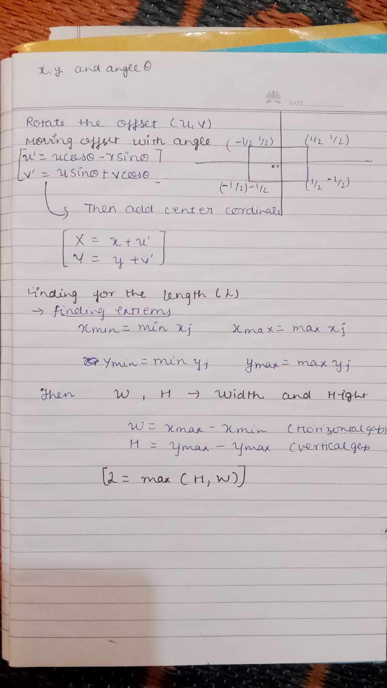

# Kaggle: Squares in Squares Optimization Challenge 🟥

This repository contains the foundational geometry engine for the Kaggle Squares in Squares spatial optimization competition. 

## 📐 Core Mathematical Logic

The algorithm computes valid placements using the exact formulas derived in the project notes below:

### Key Components:
*   **Vertex Transformation:** Computes rotated offsets $(u', v')$ using $\sin\theta$/$\cos\theta$ matrices, then translates them to global $(X, Y)$ coordinates.
*   **Container Dimensions ($L$):** Tracks global coordinate extremes ($x_{min}, x_{max}, y_{min}, y_{max}$) to calculate the minimum axis-aligned square container length:  
    $$L = \max(H, W)$$
*   **Collision Detection:** Implements the **Separating Axis Theorem (SAT)** to project vertices onto orthogonal axes and ensure zero overlap between shapes.

---

## 🛠️ Status
- [x] Mathematical formulation & rotation engine
- [x] Axis-aligned bounding container calculation ($L$)
- [ ] SAT overlap verification loop implementation
